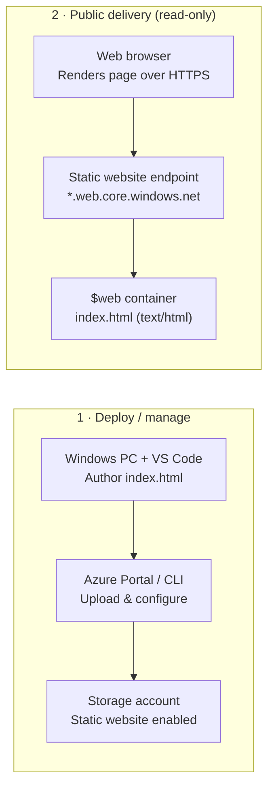
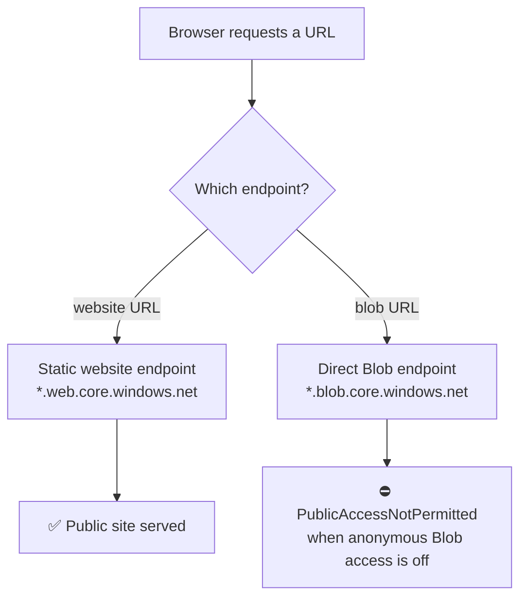
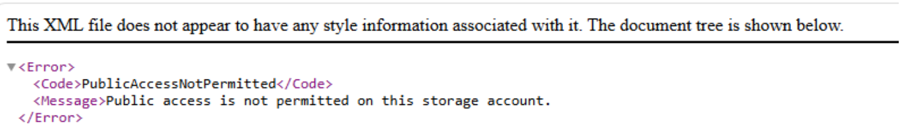
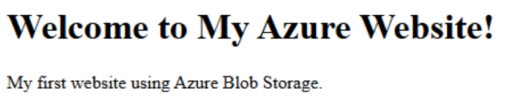

# Azure Cloud Lab 01: Static Website Hosting with Azure Blob Storage

A hands-on lab: I built a static site in VS Code, served it from the Azure Storage `$web` container, and fixed a `PublicAccessNotPermitted` error **without weakening security**.

| Area | Details |
|---|---|
| **Outcome** | Static HTML page served from Azure Storage over HTTPS. Site confirmed working. |
| **Azure services** | Storage account (StorageV2, Standard, LRS), Static website feature, `$web` container |
| **Tools** | Windows PC, Visual Studio Code, Azure Portal, Azure CLI, web browser |
| **Skills shown** | Cloud hosting, endpoint troubleshooting, storage access control, documentation |

📄 **Full write-up (PDF):** [docs/Azure_Static_Website_Lab.pdf](docs/Azure_Static_Website_Lab.pdf)

## Demo video

_Video coming soon._

## 1. Objective

Create a static HTML site on a Windows PC, store it in the Azure Storage `$web` container, and make it reachable through the Static website **Primary endpoint**. No virtual machine or web server is needed.

## 2. Solution architecture

## 3. Build and deploy (Azure Portal)

1. **Create the HTML file** in VS Code: [site/index.html](site/index.html).
2. **Create a storage account**: Standard performance, LRS redundancy, StorageV2 (general-purpose v2).
3. **Enable Static website** (Data management > Static website), index document `index.html`, Save.
4. **Upload** `index.html` to the root of the `$web` container (Content type `text/html`).
5. **Open the Primary endpoint** `https://<account>.<zone>.web.core.windows.net`.

**Repeatable version:** [scripts/deploy.sh](scripts/deploy.sh) does the whole lab with the Azure CLI; [scripts/cleanup.sh](scripts/cleanup.sh) deletes it.

## 4. Security: two different endpoints

| Security control | Implementation |
|---|---|
| Public content | Everything in `$web` is public. Never upload secrets. |
| Blob access | Keep anonymous Blob access **off**. Don't enable it to troubleshoot a website URL. |
| Least privilege | Only approved identities can upload files or change settings. |
| HTTPS | Share the Primary endpoint over HTTPS. |

## 5. Troubleshooting

**Resolution:** the site worked on the static website endpoint. The likely cause was using a direct Blob URL. Anonymous Blob access was **not** enabled as a workaround.

| Symptom | Fix |
|---|---|
| `PublicAccessNotPermitted` | Use the Static website Primary endpoint, not a Blob URL. |
| 404 | Index document is `index.html`, file at the root of `$web`. |
| Page downloads instead of showing | Content type is `text/html`. |

## 6. Result

## 7. What I learned

- Azure Storage has more than one endpoint, each with its own access rules.
- An access error is often security working as designed: fix the request, don't loosen the control.
- Content in `$web` is public by design, so what you upload matters.
